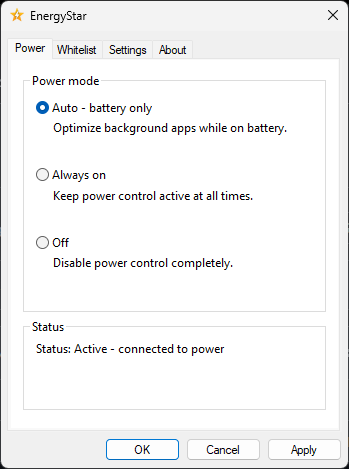

<p align="center">
  
</p>

<h1 align="center">EnergyStar</h1>

<p align="center">
  Lightweight background efficiency and battery optimizer for Windows 11 and 10.
</p>

<p align="center">
  <a href="https://github.com/DARKBOYJYOTI/EnergyStar/releases/latest">
    
  </a>
  <a href="https://github.com/DARKBOYJYOTI/EnergyStar/releases">
    
  </a>
  <a href="LICENSE">
    
  </a>
</p>

---

## Overview

EnergyStar keeps your laptop running cool and extends battery life by applying Windows EcoQoS (Efficiency Mode) and idle priority to background applications. When you switch between windows, your active application and its child processes automatically receive full CPU performance.

<p align="center">
  
</p>

Available as both a **standalone single-executable portable build** and a **guided installer** for both x64 and ARM64.

---

## Features

- **Dynamic EcoQoS**: Throttles inactive background apps without affecting foreground responsiveness.
- **Three Power Modes**: Auto (battery only), Always on, or Off.
- **Smart Whitelist**: Keep selected apps at full speed. Easily add executables or desktop shortcuts (`.lnk`).
- **Single Native Binary**: UI, background service, and session event agent are hosted in a single lightweight C++ binary with no dependencies or runtimes.
- **Privacy-First**: No telemetry, no background network calls, and 100% local configuration.

---

## Download

Get the latest installer or standalone portable executable:

<p align="center">
  <a href="https://github.com/DARKBOYJYOTI/EnergyStar/releases/latest">
    
  </a>
</p>

| Package | Architecture | Description |
| :--- | :--- | :--- |
| **Setup Installer** | x64 / ARM64 | Installs service, autostart, and shortcuts |
| **Standalone Portable** | x64 / ARM64 | Single `.exe`, no installation required |

---

## Development & Building

### Prerequisites
- Visual Studio 2022 (Desktop development with C++)
- Windows 11 SDK (10.0.22000 or newer)
- CMake 3.24+

### Build Steps

```powershell
# Clone the repository
git clone https://github.com/DARKBOYJYOTI/EnergyStar.git
cd EnergyStar

# Configure and build for x64
cmake -S Native -B build -A x64
cmake --build build --config Release

# Built binary: build/bin/EnergyStar.exe
```

For ARM64, replace `-A x64` with `-A ARM64`.

### Project Structure
- `Native/Main.cpp`: Entry point routing between UI, service, and agent modes.
- `Native/UI/`: Native Win32 property sheet UI with Segoe UI styling.
- `Native/Service/`: Core Windows service managing EcoQoS and process priority states.
- `Native/Agent/`: Lightweight user session helper monitoring foreground window focus.
- `Package/`: Inno Setup installer packaging script.

---

## Credits & License

- Developed by **[darkboyjyoti](https://github.com/DARKBOYJYOTI)**
- Based on the original CLI concept by **[imbushuo](https://github.com/imbushuo)**

Released under the [MIT License](LICENSE).
